# Project 004 — Active Directory Penetration Testing Lab

## Overview

Built an isolated Windows Server 2025 Active Directory environment and assessed it from Kali Linux. This project covers network and directory-service enumeration, secure LDAP configuration, Kerberos-related account exposure, remediation, and independent verification. All testing was conducted against systems and accounts created for this lab.

**Assessment outcome:** One intentionally introduced AS-REP roasting misconfiguration was detected and remediated. A service account with an SQL SPN was discovered, but Kerberoasting ticket retrieval **did not succeed** because the KDC returned `KDC_ERR_ETYPE_NOSUPP`. No passwords were cracked or accounts compromised.

## Lab environment and scope

| Component | Configuration |
| --- | --- |
| Virtualization | VMware Workstation Pro, isolated host-only network |
| Domain controller | Windows Server 2025, `DC01.corp.lab`, `192.168.42.10` |
| Active Directory domain | `corp.lab` (`CORP`) |
| Assessment host | Kali Linux, `192.168.42.129` |
| Network | `192.168.42.0/24` |
| Test identity | `jcarter@corp.lab`, standard domain user |
| Controlled test accounts | `asrep-lab`, `svc-sql-lab` |

**Scope:** Domain configuration verification, network/service enumeration, authenticated LDAPS directory queries, and controlled Kerberos account-configuration assessments. The SQL SPN was a fictional lab registration; no SQL Server service was deployed.

## Tools

Windows PowerShell Active Directory module, `setspn`, Nmap, OpenLDAP `ldapsearch`, OpenSSL, and Impacket `GetUserSPNs`.

## Methodology and evidence

### 1. Build and validate Active Directory

Configured `DC01` as a domain controller for `corp.lab`, created IT/HR/Finance organizational units, populated test users and groups, and validated domain/DNS functionality.


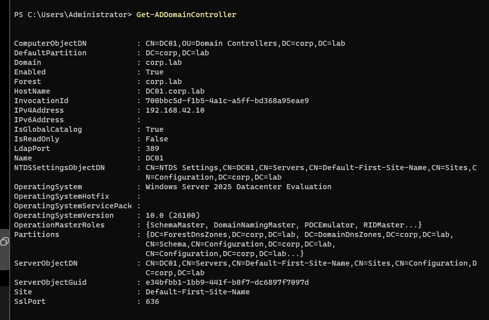
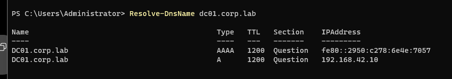
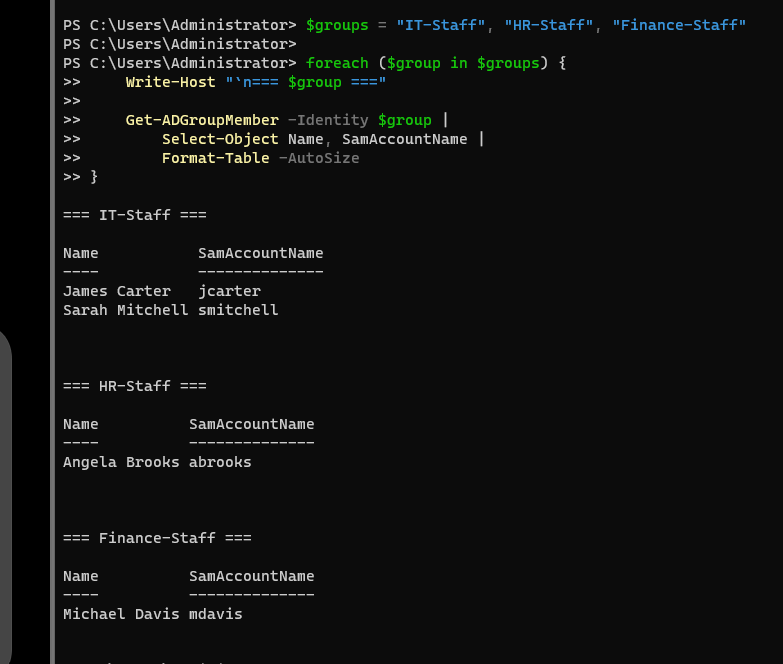

### 2. Enumerate exposed services and security controls

From Kali, scanned domain-controller services and checked SMB signing:

```bash
sudo nmap -sV -Pn -p 53,88,135,139,389,445,464,636,3268,3269 192.168.42.10
sudo nmap -Pn -p 445 --script smb2-security-mode 192.168.42.10
```

Observed expected AD services. SMB 3.1.1 signing was **enabled and required**, a verified security control—not a vulnerability.

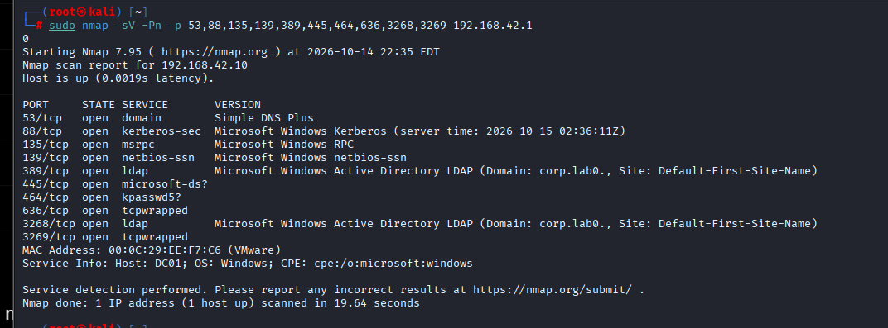
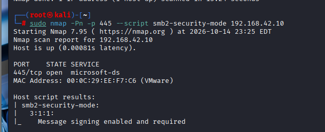

### 3. Compare anonymous LDAP and authenticated LDAPS

Anonymous RootDSE metadata was readable, while anonymous directory-user enumeration was rejected. An insecure LDAP simple bind was also rejected because the server required stronger authentication. Configured an LDAPS server certificate, validated the TLS handshake, and performed authenticated directory searches over TLS.

```bash
ldapsearch -x -H ldap://192.168.42.10 -s base -b "" defaultNamingContext namingContexts dnsHostName
ldapsearch -x -H ldap://192.168.42.10 -b "DC=corp,DC=lab" "(objectClass=user)" sAMAccountName

LDAPTLS_REQCERT=demand ldapsearch -x \
  -H ldaps://dc01.corp.lab:636 -D 'jcarter@corp.lab' -W \
  -b 'DC=corp,DC=lab' '(objectClass=user)' sAMAccountName
```

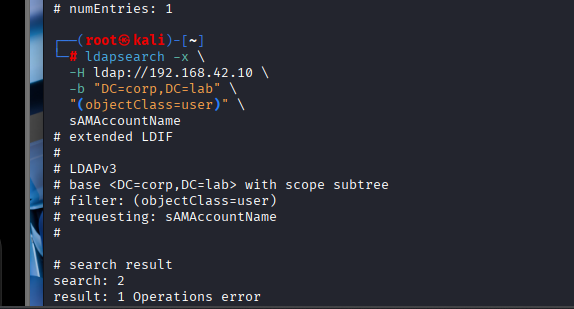
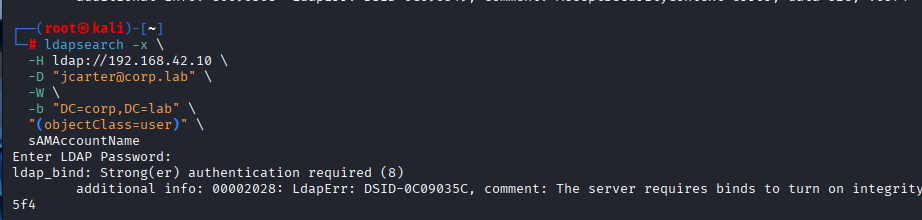
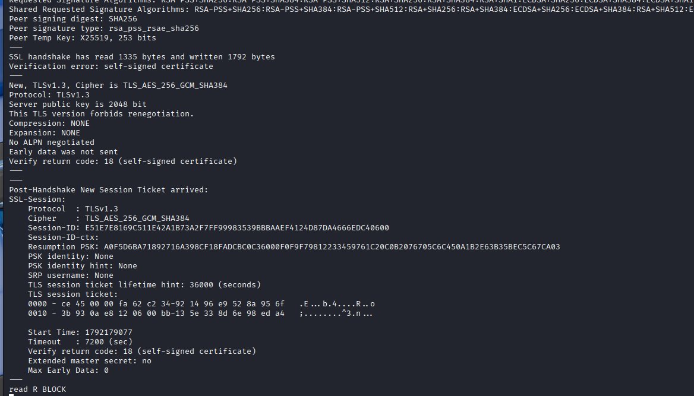
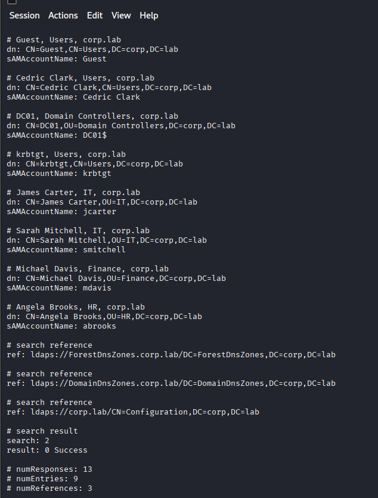
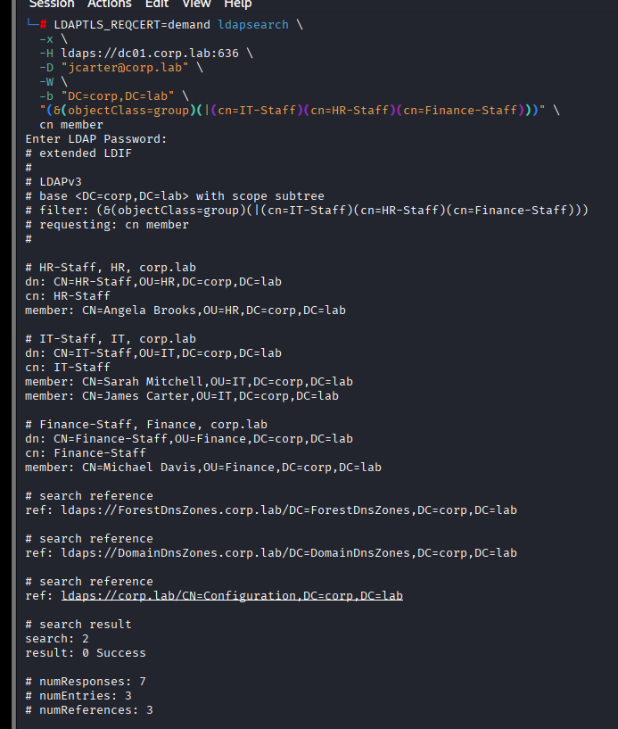
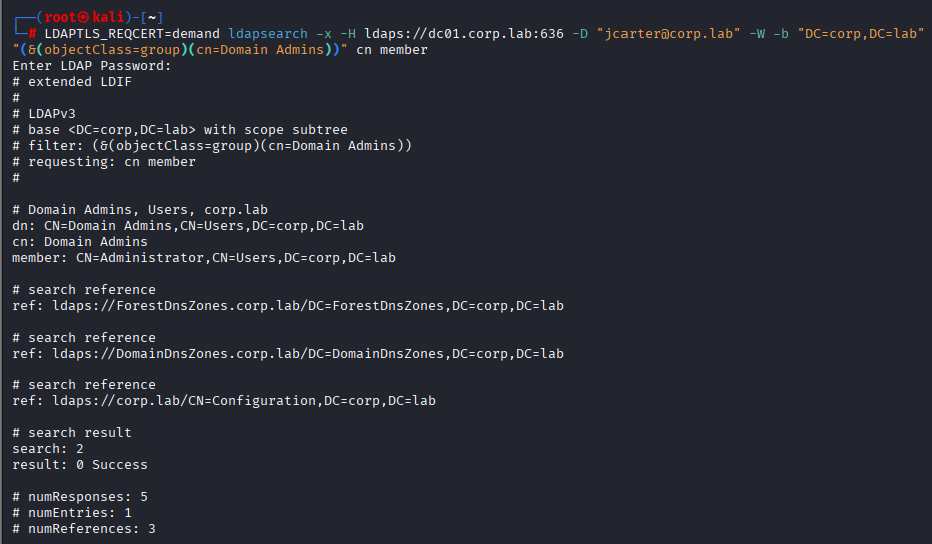

### 4. Finding AD-001 — Kerberos preauthentication disabled (controlled misconfiguration)

**Status: Remediated and independently verified.**

Created and enabled the dedicated `asrep-lab` test user. Its baseline `DoesNotRequirePreAuth` value was `False`. Intentionally set it to `True` on DC01 and detected the `DONT_REQ_PREAUTH` bit (`4194304`) through authenticated LDAPS from Kali:

```powershell
Set-ADAccountControl -Identity 'asrep-lab' -DoesNotRequirePreAuth $true
```

```bash
LDAPTLS_REQCERT=demand ldapsearch -x \
  -H ldaps://dc01.corp.lab:636 -D 'jcarter@corp.lab' -W \
  -b 'DC=corp,DC=lab' \
  '(&(objectCategory=person)(objectClass=user)(userAccountControl:1.2.840.113556.1.4.803:=4194304))' \
  sAMAccountName userAccountControl
```

**Observed:** `asrep-lab` appeared with `userAccountControl: 4194816`, and the LDAP search completed successfully. This demonstrates exposure to potential AS-REP roasting, **not** successful password recovery.

**Remediation:**

```powershell
Set-ADAccountControl -Identity 'asrep-lab' -DoesNotRequirePreAuth $false
Get-ADUser -Identity 'asrep-lab' -Properties Enabled,DoesNotRequirePreAuth |
  Select-Object Name,SamAccountName,Enabled,DoesNotRequirePreAuth
```

Windows verification showed `DoesNotRequirePreAuth = False`. Repeating the same LDAPS filter from Kali returned **zero matching entries** with `result: 0 Success`.

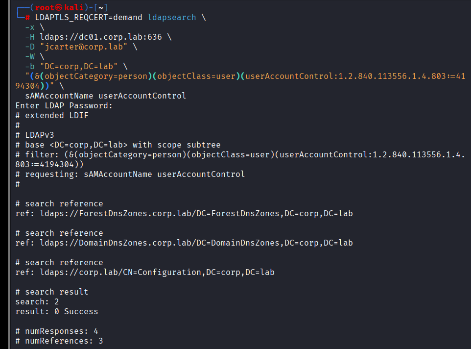
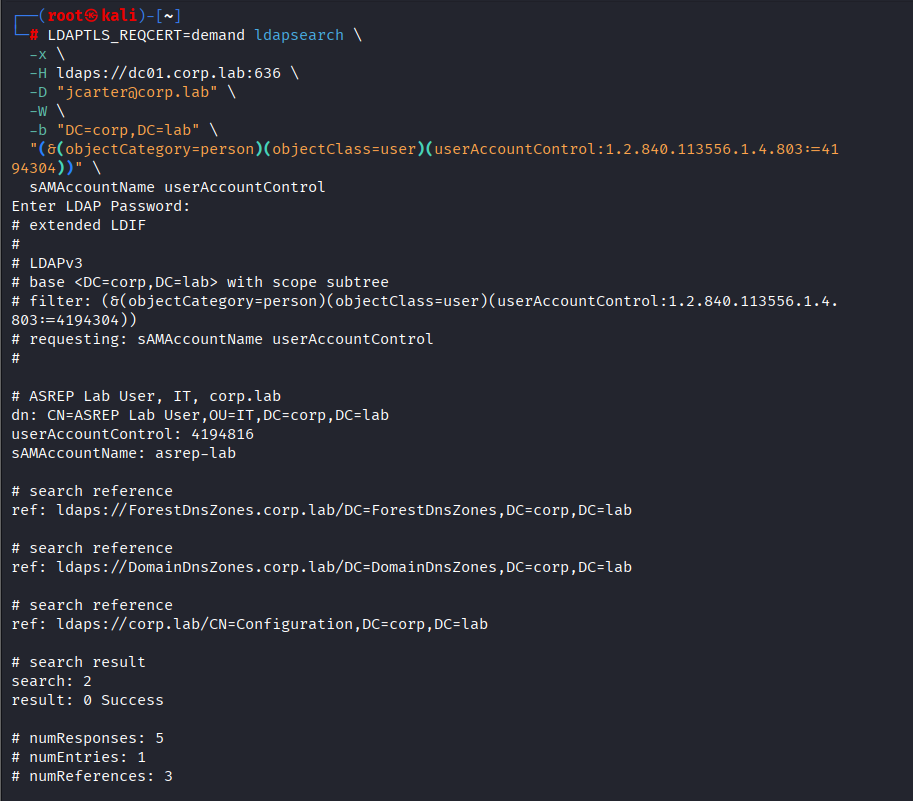
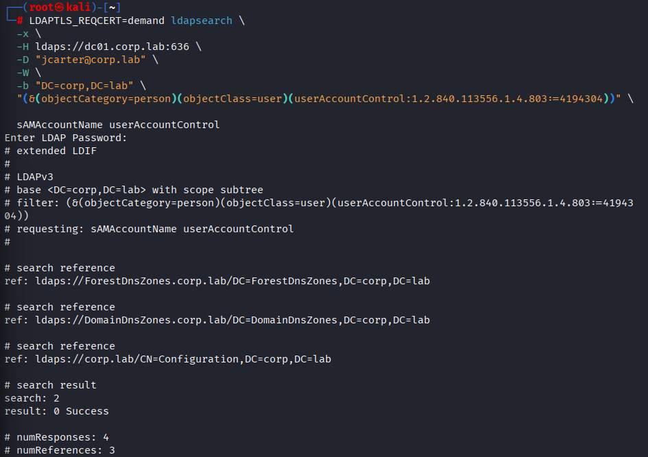

### 5. Assessment AD-002 — SQL SPN / Kerberoasting reconnaissance

**Status: SPN discovery verified; service-ticket request unsuccessful.**

Created the dedicated `svc-sql-lab` account and registered a fictional SQL service SPN:

```powershell
setspn -S MSSQLSvc/sql01.corp.lab:1433 CORP\svc-sql-lab
setspn -L CORP\svc-sql-lab
```

Enumerated it from Kali with the standard `jcarter` identity:

```bash
LDAPTLS_REQCERT=demand ldapsearch -x \
  -H ldaps://dc01.corp.lab:636 -D 'jcarter@corp.lab' -W \
  -b 'DC=corp,DC=lab' \
  '(&(objectCategory=person)(objectClass=user)(servicePrincipalName=MSSQLSvc/*))' \
  sAMAccountName servicePrincipalName
```

**Observed:** `svc-sql-lab` was returned with `MSSQLSvc/sql01.corp.lab:1433`.

Attempted a Kerberos service-ticket request using Impacket:

```bash
impacket-GetUserSPNs 'corp.lab/jcarter' \
  -dc-ip 192.168.42.10 -dc-host dc01.corp.lab \
  -request -outputfile /root/kerberoast-lab.txt
```

**Observed:** Impacket enumerated the SPN but ticket retrieval failed with `KDC_ERR_ETYPE_NOSUPP`. Explicitly setting AES128/AES256 (`msDS-SupportedEncryptionTypes = 24`) and resetting the lab account password did not resolve the error. A relevant failed Security Event 4769 was not found in the examined time window. **No ticket retrieval or offline cracking success is claimed.**

**Cleanup:** Removed the fictional SPN and disabled the unused test account:

```powershell
setspn -D MSSQLSvc/sql01.corp.lab:1433 CORP\svc-sql-lab
Disable-ADAccount -Identity 'svc-sql-lab'
Get-ADUser -Identity 'svc-sql-lab' -Properties Enabled,ServicePrincipalName |
  Select-Object SamAccountName,Enabled,ServicePrincipalName
```

**Verified:** `Enabled = False`; `ServicePrincipalName = {}`.

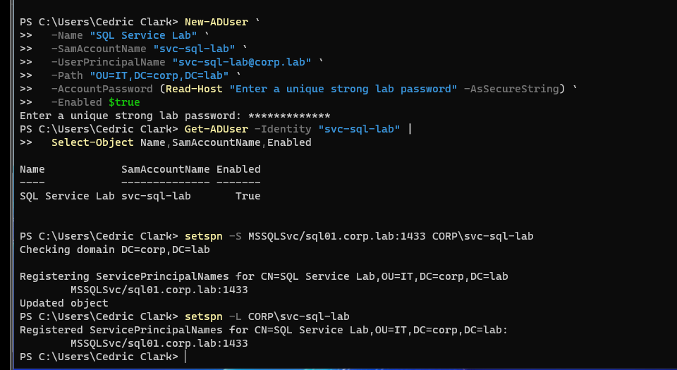
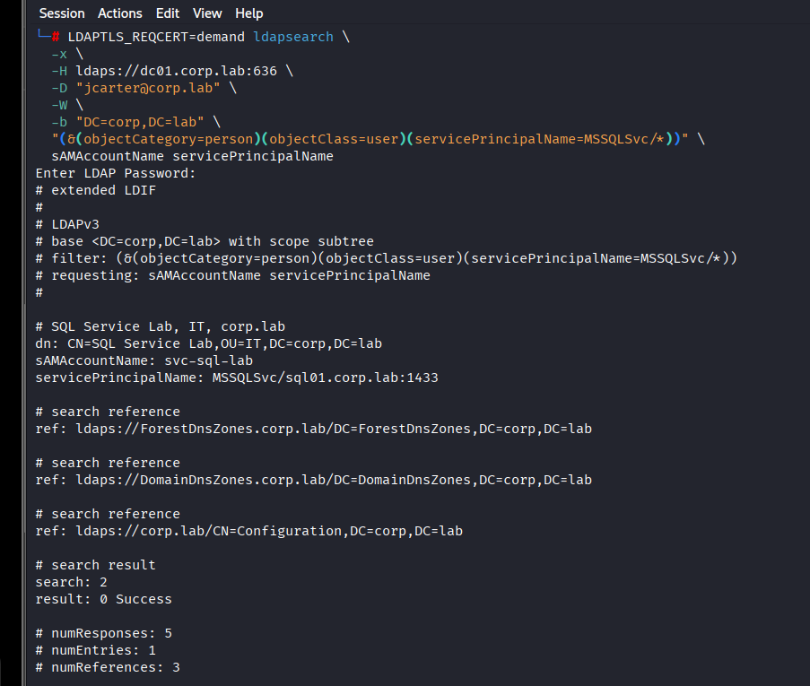
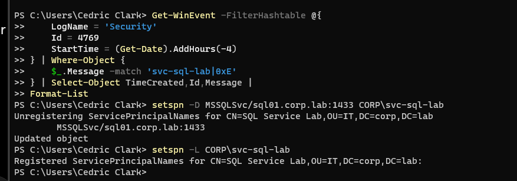
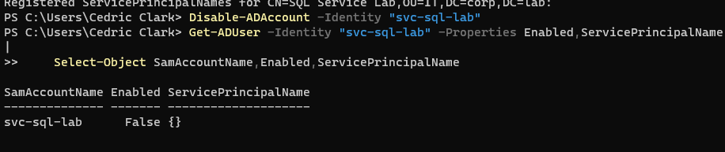

## Findings summary

| ID | Assessment | Verified outcome | Final status |
| --- | --- | --- | --- |
| AD-001 | Kerberos preauthentication disabled | Controlled exposure discovered using LDAPS; fix retested | Remediated |
| AD-002 | SPN / Kerberoasting reconnaissance | Service account and SPN discovered; ticket request failed | Lab SPN removed, account disabled |
| Control-001 | SMB signing | Signing enabled and required | Security control verified |
| Control-002 | LDAP authentication | Anonymous directory search restricted; unsigned simple bind rejected | Security control verified |

## Lessons learned

- An SPN is a reconnaissance lead, not proof of successful Kerberoasting.
- LDAP directory metadata exposure, authenticated enumeration, and actual exploitation are different evidence levels.
- LDAPS certificate trust and hostname resolution matter for secure assessment tooling.
- Modern Kerberos encryption behavior can affect tool compatibility; report unsuccessful attempts rather than assuming exploitation.
- A professional assessment includes cleanup and post-remediation verification.

## Portfolio integrity and handling

All IP addresses, identities, and domains in this repository belong to an isolated practice environment. Passwords, private keys, Kerberos tickets, and ticket/hash output files are intentionally excluded. Screenshots are retained as evidence of specific commands and observed results. No production environment was tested.
